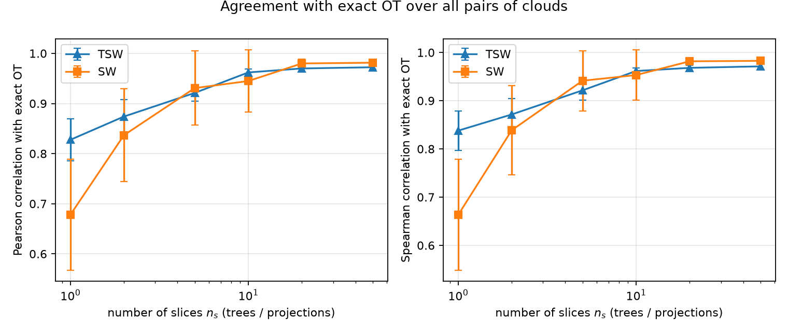
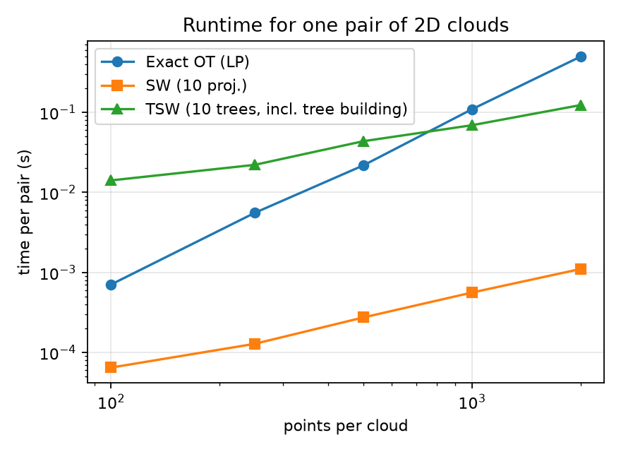
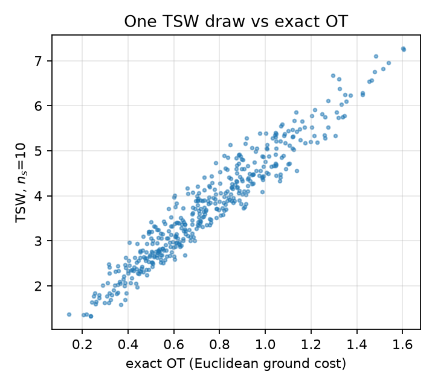

# Tree-Sliced Wasserstein: a toy reproduction

This project is a small, from-scratch implementation of part of **“Tree-Sliced
Variants of Wasserstein Distances”** by Tam Le, Makoto Yamada, Kenji Fukumizu,
and Marco Cuturi (NeurIPS 2019). It is an educational toy experiment, **not a
reproduction of the paper's full experimental results**.

## Scope

The implementation in [`tsw.py`](./tsw.py) covers:

- The paper's partition-based tree construction (Algorithm 1), using a
  randomly shifted quadtree for two-dimensional supports.
- Tree-Wasserstein distance using the closed form in Proposition 1, Eq. (3):
  the weighted L1 distance between subtree-mass features.
- Tree-Sliced Wasserstein distance using Eq. (4), averaging over independently
  sampled trees.
- Sliced Wasserstein (SW), using random one-dimensional projections, and exact
  Wasserstein-1 optimal transport (OT), using Euclidean ground costs and POT.

The paper also describes clustering-based trees for high-dimensional supports
and evaluates kernels and downstream learning tasks. Those methods and
experiments are **not implemented here**.

## Data and experiment protocol

The experiments use synthetic data only: 30 independently parameterized point
clouds (10 each of two-cluster Gaussian blobs, noisy rings, and noisy two-moons),
with 200 equally weighted points per cloud in 2D. Dataset generation uses seed
`0`. Exact Euclidean OT is computed for all 435 unordered cloud pairs and used
as a reference.

For agreement experiments, TSW tree depth is fixed at 6. Both TSW's number of
trees and SW's number of projections use `n_s` in `{1, 2, 5, 10, 20, 50}`.
Pearson and Spearman correlations are calculated over the 435 pairwise
distances. Each reported value is the mean ± population standard deviation over
five stochastic repeats. A fresh draw is used for each repeat and each `n_s`;
the draws are **not nested** as `n_s` increases. These correlations measure
agreement with this toy dataset's exact-OT distances, not accuracy on the
paper's datasets or performance on a downstream task.

## Results

### Agreement with exact OT

| `n_s` | TSW Pearson | SW Pearson | TSW Spearman | SW Spearman |
|---:|---:|---:|---:|---:|
| 1  | 0.828 ± 0.042 | 0.678 ± 0.111 | 0.838 ± 0.041 | 0.663 ± 0.115 |
| 2  | 0.874 ± 0.034 | 0.837 ± 0.093 | 0.871 ± 0.033 | 0.839 ± 0.093 |
| 5  | 0.921 ± 0.016 | 0.931 ± 0.074 | 0.921 ± 0.020 | 0.941 ± 0.063 |
| 10 | 0.962 ± 0.007 | 0.945 ± 0.062 | 0.962 ± 0.006 | 0.953 ± 0.052 |
| 20 | 0.970 ± 0.005 | 0.980 ± 0.009 | 0.968 ± 0.005 | 0.982 ± 0.007 |
| 50 | 0.972 ± 0.004 | 0.981 ± 0.005 | 0.971 ± 0.005 | 0.983 ± 0.005 |

On this 2D toy dataset, agreement generally increases with more trees or
projections. TSW is ahead at `n_s = 1, 2, 10`, while SW is ahead at `n_s = 5,
20, 50`. The spread across repeats is smaller for TSW in these runs, but five
repeats are too few to support broad statistical conclusions. SW's strong
performance is unsurprising in two dimensions; this experiment does not test
the paper's high-dimensional motivation.



### Runtime

Single-pair runtime in milliseconds; medians of three repetitions. TSW time
includes tree construction, and SW uses 10 projections / TSW uses 10 trees.

| Points per cloud | Exact OT | SW | TSW |
|---:|---:|---:|---:|
| 100  | 0.71 | 0.06 | 14.15 |
| 250  | 5.56 | 0.13 | 22.11 |
| 500  | 21.77 | 0.27 | 43.66 |
| 1,000 | 109.41 | 0.56 | 69.14 |
| 2,000 | 497.49 | 1.11 | 123.36 |

In this run, the unoptimized Python TSW implementation becomes faster than
exact OT at around 1,000 points per cloud. SW is much faster than either method
at all measured sizes. These are machine- and implementation-specific
measurements, not complexity guarantees or a claim that TSW is generally faster.
The agreement experiment constructs each tree over the pooled supports and
uses it for all cloud pairs in that distance matrix; the runtime experiment
includes construction for its pair.





`results.json` contains the full-precision agreement and runtime values from
the latest run. Runtime values can change between runs and machines.

## Validation

Run `validate.py` to compare the Eq. (3) closed form with POT's exact linear
programming OT solver using the same tree metric as the ground cost. On the
included run, the maximum absolute difference over 10 pairs was
`3.55e-15`; the script asserts the difference is below `1e-8`.

This validates the tree-distance calculation for those test cases. It does
not establish that the toy experiment reproduces the paper's broader claims.

## Reproduce

Python 3.14.4 was used for the run documented above. Create and activate an
environment, install the direct dependencies, and run:

```bash
python3 -m venv .venv
source .venv/bin/activate
python -m pip install -r requirements.txt
python validate.py
python experiments.py
```

`experiments.py` regenerates `fig_runtime.png`, `fig_agreement.png`,
`fig_scatter.png`, and `results.json` in the current directory. The tested
dependency versions were NumPy 2.5.4, SciPy 1.18.1, Matplotlib 3.11.2, and
POT 0.9.7.post1; `requirements.txt` lists these direct dependencies without
version pins.

## Limitations

- Synthetic 2D data only; no paper datasets, real data, or high-dimensional
  clustering-based trees.
- Tree depth is fixed at 6 and was not tuned.
- Agreement is measured against exact OT on the same toy clouds, not task
  accuracy or a broad theoretical guarantee.
- Only one dataset-generation seed and five stochastic repeats are used.
- Runtime figures are a small, local benchmark and are not optimized or
  hardware-independent.
